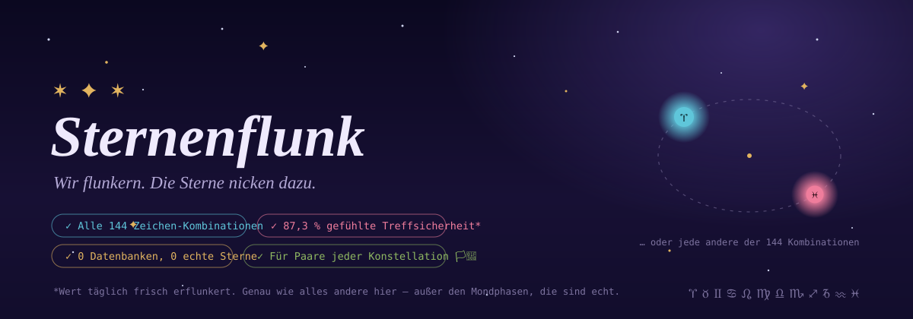
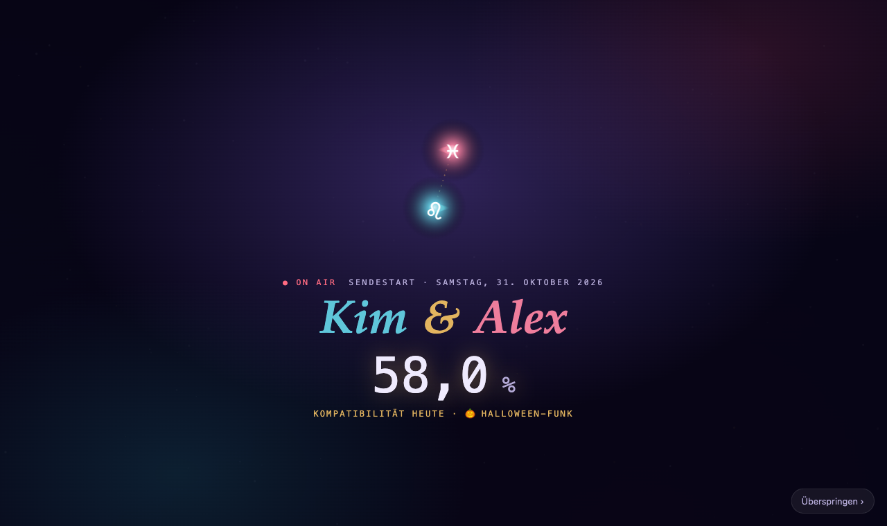
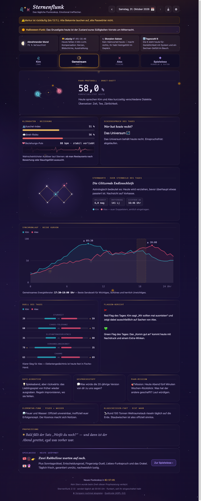
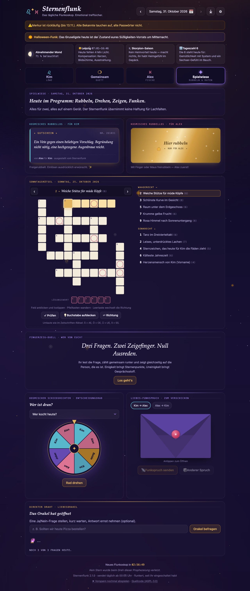
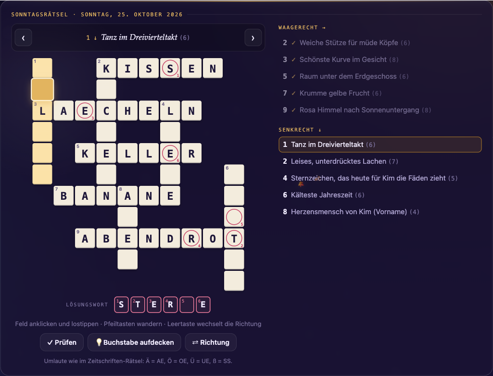
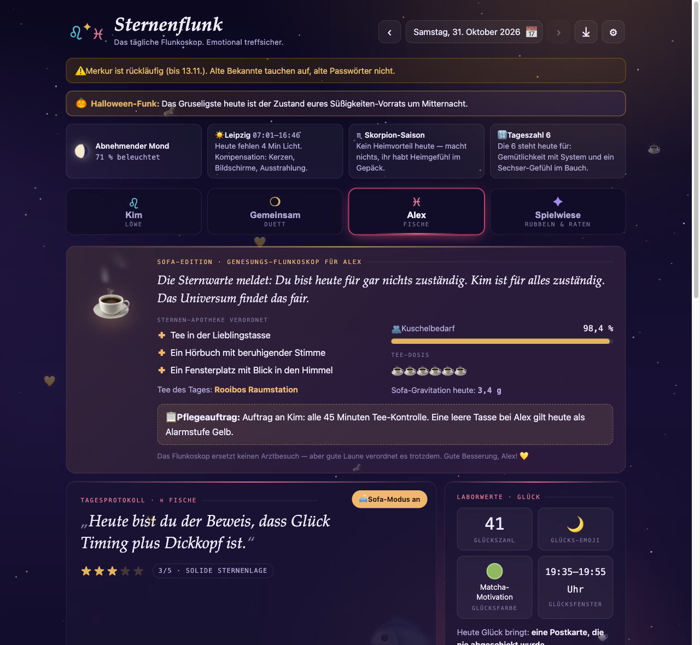
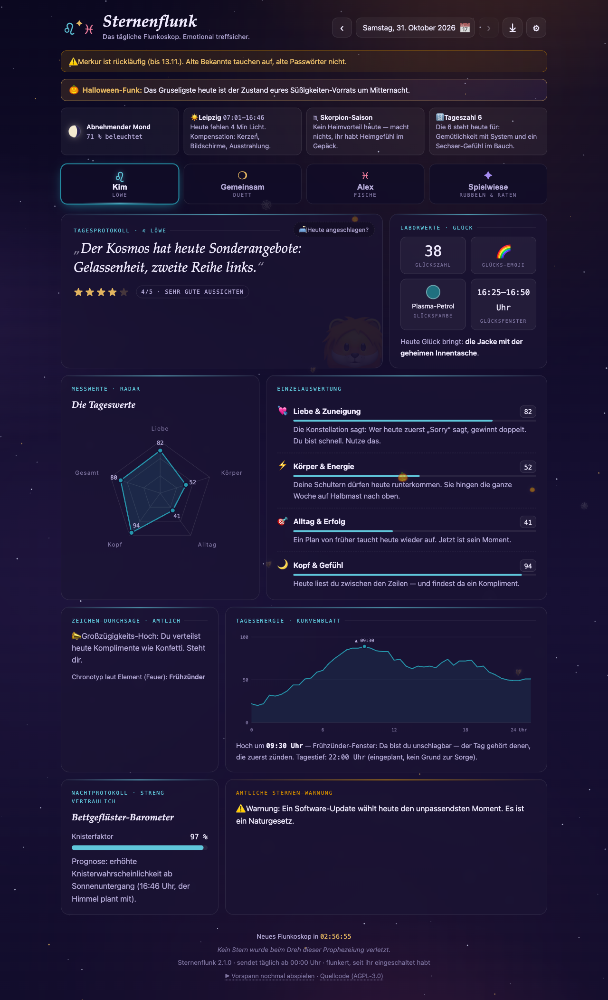
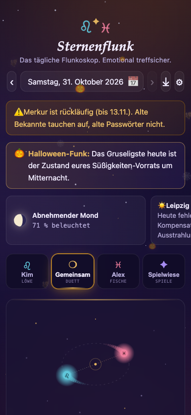
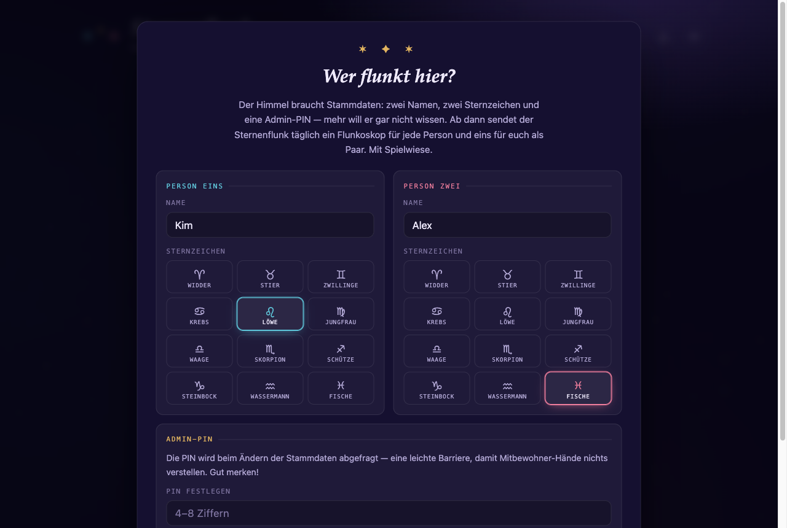
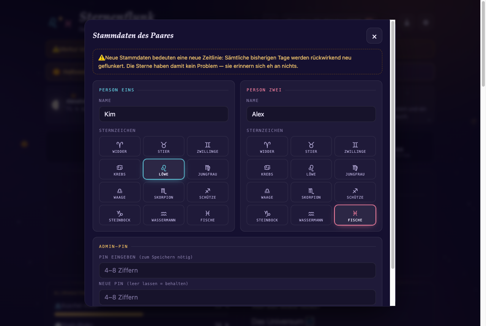

<p align="center">
  
</p>

# ✶ Sternenflunk

**Das tägliche Paar-Flunkoskop für euch zwei. Ja, genau euch.**
Täglich frisch geflunkert. Emotional treffsicher.

Sternenflunk ist eine selbstgehostete Mini-Web-App für genau ein Paar: Beim
ersten Start tragt ihr zwei Namen und zwei Sternzeichen ein — ab dann sendet
der Flunk jeden Tag ein Flunkoskop pro Person plus ein gemeinsames
Paar-Protokoll. Mit Kino-Vorspann, Orbit-Duett, Sternbild des Tages,
Energie-Kurven, einer Spielwiese voller Rubbellose und Fingerzeig-Duelle,
echten Astronomie-Daten und einem Archiv aller vergangenen Tage. Die Zukunft
bleibt versiegelt. 🔮

> **Flunkoskop, das:** Ein Horoskop, das zugibt, dass es flunkert — und
> gerade deshalb stimmt.

> *„Endlich sagt mir jemand täglich, wann ich recht habe."*
> — Person Eins ★★★★★
>
> *„Ich wurde als ‚Vormittagsfels' klassifiziert und fühle mich gesehen."*
> — Person Zwei ★★★★★
>
> *„Wissenschaftlich haltlos."*
> — Ein Satellit, der es wissen muss ★★★★★

## Warum Sternenflunk?

Weil klassische Horoskope für Millionen geschrieben werden — und eures nur
für euch. Sternenflunk kennt eure Namen, eure Zeichen, eure Element-Chemie
und behauptet dann Dinge mit zwei Nachkommastellen. Das ist keine Astrologie.
Das ist **Flunkologie**: die Kunst, so präzise zu schwindeln, dass es sich
wie Schicksal anfühlt.

## Features

- **Onboarding in 30 Sekunden:** zwei Namen, zwei Sternzeichen, eine
  Admin-PIN, fertig. Alle 144 Kombinationen, jede Konstellation — Frau & Frau,
  Mann & Mann, zweimal Steinbock: Der Himmel ist da komplett entspannt.
- **Admin-Zahnrad ⚙ mit PIN:** Stammdaten jederzeit änderbar — aber nur mit
  der beim Onboarding festgelegten Admin-PIN (4–8 Ziffern). Eine leichte
  Barriere, damit Mitbewohner-Hände nichts verstellen. Achtung: Neue
  Stammdaten = neue Zeitlinie, alles wird rückwirkend neu geflunkert.
- **Vier Ansichten:** Person Eins · Gemeinsam (Paar-Protokoll) · Person Zwei
  · Spielwiese
- **Sendestart-Vorspann:** Einmal am Tag fliegen eure Zeichen ins Bild,
  umkreisen sich, Sternen-Burst — dann Namen, Datum und die Kompatibilität
  des Tages. Danach schweben die Karten ein, Zahlen zählen hoch, Kurven
  zeichnen sich selbst. Motion Graphics komplett in Canvas, SVG und CSS.
- **Sternbild des Tages:** täglich ein neues Paar-Sternbild — „Die
  Kuschelnde Kaffeetasse“, „Der Verschlafene Papierflieger“ —, das sich Stern
  für Stern zeichnet, inklusive eures Doppelsterns.
- **Sonntagsrätsel:** jeden Sonntag ein kleines Kreuzworträtsel mit
  Lösungswort — mit eigener Bildschirmtastatur fürs Handy, Prüfen-Knopf,
  Buchstaben-Joker und ein, zwei Fragen, die nur ihr beantworten könnt.
- **Spielwiese:** zwei Rubbellose mit Gutscheinen füreinander,
  Fingerzeig-Duell „Wer von euch?“ mit 3-2-1-Countdown, Entscheidungsrad
  („Wer kocht heute?“), Liebes-Funkspruch im Umschlag zum Verschicken und
  das Liebesorakel. Alles auf einem Gerät, alles für zwei.
- **Sofa-Modus:** Wer angeschlagen ist, schaltet die Sofa-Edition ein —
  Genesungs-Prognose, Sternen-Apotheke, Tee des Tages und ein Pflegeauftrag
  für die andere Hälfte.
- **Täglich neu, für immer reproduzierbar:** deterministischer Generator,
  geseedet aus Datum + Paar-Fingerabdruck. Ausgelieferte Tage werden als
  JSON eingefroren und ändern sich nie wieder.
- **Zeichen mit Charakter:** Element-Chronotypen (Feuer zündet früh, Wasser
  lebt abends auf), amtliche Zeichen-Durchsagen, zeichen-eigene Glücksbringer
  („der Blick — zählt heute als Gegenstand", Skorpion).
- **Elementar-Funk:** die tägliche Element-Chemie eurer Zeichen —
  von „Dampf!" (Feuer + Wasser) bis „Synchronschwimmen ohne Publikum"
  (Wasser + Wasser).
- **Orbit-Duett** (Signatur-Element): zwei Himmelskörper mit euren
  Zeichen-Glyphen und Kometenschweifen kreisen umeinander — Abstand und Tempo
  entsprechen der Tages-Kompatibilität. An Jackpot-Tagen (≥ 96 %) wird die
  Bahn zum Herz (plus Konfetti), an Chaos-Tagen taumelt sie.
- **Charts, handgerollt in SVG:** Radar, Energie-Kurven mit gemeinsamem
  Energiefenster (Hover-Tooltip!), Battle-Duell, Meter. Keine Bibliotheken.
- **Amtlicher Tagesbericht als PDF ⤓:** Ein Klick neben dem Zahnrad bannt
  den angezeigten Tag — auch jeden Archiv-Tag — auf mehreren A4-Seiten im
  App-Look: Cover mit kosmischer Großwetterlage, Paar-Protokoll, beide
  Personen, sämtliche Charts, Nachthimmel inklusive. Entsteht komplett im
  Browser (handgerollter PDF-Writer, natürlich ohne Bibliotheken) — zum
  Ausdrucken, Verschicken oder feierlichen Abheften.
- **Echte Astronomie, ehrlich gemischt:** Mondphase, Sonnenauf-/-untergang
  (Standort konfigurierbar), Tierkreis-Saison mit Heimspiel-Logik,
  Merkur-Retrograde-Banner. Die Deutung ist geflunkert, die Daten nicht.
- **Liebesorakel (auf der Spielwiese):** 3 Ja/Nein-Fragen pro Tag. Antworten von „Definitiv."
  bis „Die Antwort liegt im Kühlschrank. Ernsthaft, schau nach." — und auf
  bestimmte Fragewörter reagiert es … anders. (Tipp: Pizza.)
- **Specials & Eastereggs:** Flunk-Meilensteine (Tag 100, 365 …),
  Flunk-Geburtstag zum Jahrestag der Erstinstallation, Feiertags-Banner
  von Valentinstag bis Silvester, Nerd-Tage (Pi-Tag, Star-Wars-Tag,
  Handtuch-Tag), Sternschnuppen-Nächte und Freitag der 13. — alles
  deterministisch, nichts davon verschiebt eure Zeitlinie.
- **Saison- & Feiertags-Deko:** Der Nachthimmel färbt sich dezent mit der
  Jahreszeit des angezeigten Tages; zu Anlässen schneit, funkelt oder
  flattert es (respektiert `prefers-reduced-motion`).
- **Über 1400 Textbausteine:** liebevoll frotzelnd, unverschämt präzise
  (87,3 %) und garantiert wiederholungsarm.
- **Keine Datenbank, kein Build, kein Framework:** PHP + Vanilla JS +
  zwei JSON-Dateien. Läuft auf jedem Hoster mit PHP — auch auf dem NAS im Flur.

## Screenshots

**Sendestart** — der tägliche Vorspann: Zeichen fliegen ein, umkreisen sich,
Sternen-Burst, dann eure Namen und die Kompatibilität des Tages.



| Paar-Protokoll mit Orbit-Duett & Sternbild | Spielwiese |
|---|---|
|  |  |

| Sonntagsrätsel mit Lösungswort | Sofa-Modus |
|---|---|
|  |  |

| Personen-Flunkoskop | Mobil |
|---|---|
|  |  |

| Onboarding — „Wer flunkt hier?" | Admin mit PIN |
|---|---|
|  |  |

*Alle Screenshots mit dem Referenzpaar Kim (Löwe) & Alex (Fische) vom 31.10.2026 (Halloween, daher die
Fledermäuse) — der Generator ist deterministisch, dieselben Stammdaten ergeben am selben Tag exakt
dieselben Bilder.*

## Schnellstart

```bash
git clone https://github.com/Bingerminger/sternenflunk.git
cd sternenflunk
php -S localhost:8018
# → http://localhost:8018 öffnen, Onboarding ausfüllen, flunken lassen
```

Ausführliche Anleitung (Webserver, Synology, Rechte, Troubleshooting):
**[INSTALL.md](INSTALL.md)**

## API

| Aufruf | Antwort |
|---|---|
| `api.php?action=meta` | Grenzen, Stammdaten, Zeichen-Katalog (`configured: false` vor dem Onboarding) |
| `api.php?action=day` | Flunkoskop von heute (Server-Zeit) |
| `api.php?action=day&date=2026-07-15` | Flunkoskop dieses Tages — nur Vergangenheit/heute |
| `api.php?action=setup` (POST) | Stammdaten speichern: `{"a":{"name":"Kim","sign":"loewe"},"b":{"name":"Alex","sign":"fische"},"pin":"2411"}` — bei Änderungen ist `pin` die bestehende PIN, optional `newPin` zum Wechseln |

Regeln: kein Setup → `409 setup_required`, falsche PIN → `403 wrong_pin`,
Zukunft → `403 future_locked`, vor der Einrichtung → `404 before_epoch`,
kaputtes Datum → `422 bad_date`. Die PIN wird nur gehasht gespeichert
(`password_hash`) und ist bewusst nicht Teil des coupleKey — ein PIN-Wechsel
lässt alle Flunkoskope in Ruhe.
Ohne Schreibrechte auf `data/` läuft die Auslieferung trotzdem — der
Generator ist deterministisch, Persistenz ist nur Einfrieren.

## Stack & Struktur

```
index.html                  Shell (Topbar, Tabs, Onboarding, Admin, Kalender)
api.php                     GET day/meta · POST setup
config.php                  Zeitzone, Standort, Version
lib/Rng.php                 Deterministischer Zufall (xorshift32, crc32-Seed)
lib/Zodiac.php              12 Zeichen + Elemente + Chronotypen
lib/Couple.php              Stammdaten: laden, validieren, speichern, coupleKey
lib/Astro.php               Mond, Sonne, Saison, Merkur, Numerologie
lib/Content.php             Alle Textpools (die Flunk-Redaktion)
lib/HoroscopeGenerator.php  Baut den Tag aus Pools + Astronomie + Paar
lib/Crossword.php           Sonntagsrätsel: freies Kreuzworträtsel mit Lösungswort
assets/css/styles.css       Cosmic Dark, Motion (Reveal, Nebel, Rätsel-Papier)
assets/js/app.js            State, Router, Rendering der vier Ansichten, Sofa-Modus
assets/js/charts.js         Handgerollte SVGs: Radar, Energie, Orbit-Duett, Sternbild
assets/js/motion.js         Sendestart-Vorspann, Karten-Reveal, Hochzähler, Mond, Puls
assets/js/games.js          Spielwiese: Rubbellos, Rad, Wer-von-euch, Funkspruch, Rätsel
assets/js/widgets.js        Sternenhimmel, Kalender, Orakel, Konfetti, Countdown
assets/js/pdf.js, report.js PDF-Writer + Tagesbericht (komplett im Browser)
data/couple.json            Stammdaten des Paares (entsteht beim Onboarding)
data/days/                  Eingefrorene Tage (YYYY-MM-DD.json)
tools/deploy-acc.sh         Deploy → Synology ACC (+ Smoke-Check)
tools/deploy-prod.sh        Deploy → Synology PROD (mit Backup)
```

## Die Flunk-Physik (Determinismus)

Jedes Flunkoskop ist eine reine Funktion aus **Datum + coupleKey** (Hash aus
Namen + Zeichen). Gleicher Tag, gleiches Paar ⇒ exakt dasselbe Flunkoskop, für
immer — ganz ohne Datenbank. Einmal ausgelieferte Tage werden zusätzlich in
`data/days/` eingefroren. Ändert ihr die Stammdaten, ändert sich der
coupleKey: alte Einfrierungen werden verworfen und die gesamte Zeitlinie neu
geflunkert. Die Kompatibilitätskurve ist gestimmt auf Ø ≈ 73 % mit ~9
Jackpot- und ~3 Chaos-Tagen pro Jahr — welche Tage das sind, ist pro Paar
verschieden. Euer Jackpot gehört nur euch.

## FAQ

**Ist das echte Astrologie?**
Nein. Es ist bessere.

**Berücksichtigt ihr Aszendenten?**
Der Aszendent wurde in einer frühen Version berücksichtigt und hat sich
unmöglich benommen. Er sitzt jetzt draußen.

**Kann ich dem Flunkoskop vertrauen?**
Zu 87,3 %. Der Wert wurde nach demselben Verfahren ermittelt wie alle anderen.

**Was passiert mit unseren Daten?**
Sie liegen als eine (1) JSON-Datei auf eurem eigenen Server und langweilen
sich. Kein Tracking, keine Cloud, keine Cookies außer dem Tab-Gedächtnis.

**PIN vergessen?**
`data/couple.json` auf dem Server löschen → das Onboarding kommt wieder,
inklusive frischer PIN. Die Sterne verzeihen alles, sie vergessen ja auch alles.

## Lizenz & Ernsthaftigkeit

**Der Code** steht seit Version 2.0 unter der
[GNU Affero General Public License v3.0](LICENSE) (AGPL-3.0),
Copyright © 2026 Bingerminger. Nimm ihn, forke ihn, flunk selbst — aber
was du daraus machst, bleibt genauso offen: Wer eine veränderte Fassung
weitergibt **oder als Web-App für andere betreibt**, muss den eigenen
Quellcode unter derselben Lizenz zugänglich machen. Deshalb verlinkt die App
im Footer auf ihren Quellcode. Versionen bis 1.3.0 wurden unter der
MIT-Lizenz veröffentlicht und bleiben für alle, die sie schon haben, MIT.
Und falls der Flunk behauptet, heute sei ein Jackpot-Tag: dafür haftet
niemand — auch das steht in der Lizenz, sogar in Großbuchstaben.

**Die Prognosen** laufen weiter unter der Flunk-Lizenz™ (unwiderruflich,
galaxieweit, noch nie vor Gericht bestätigt): Privates Spaßprojekt. Keine
Sterne wurden für diese App befragt. Alle Prognosen sind frei erflunkert —
Ähnlichkeiten mit eurem tatsächlichen Dienstag sind rein kosmetisch, aber
statistisch erstaunlich häufig.
